## Executive Overview

**EsophaScope** is a specialized digital pathology workstation designed for whole-slide image (WSI) analysis, automated eosinophil granulocyte quantification, and diagnostic localization of Eosinophilic Esophagitis (EoE). EoE is a chronic allergic inflammatory disease of the esophagus defined histologically by a peak intraepithelial eosinophil density of $\ge 15$ eosinophils per standard High-Power Field ($\text{HPF} \approx 0.238\ \text{mm}^2$).

```
                      ESOPHASCOPE WORKBENCH ARCHITECTURE
 ┌────────────────────────────────────────────────────────────────────────┐
 │                      EsophaScopeWindow (QMainWindow)                   │
 │ ┌───────────────────┐ ┌──────────────────────────────────────────────┐ │
 │ │   Toolbar & HUD   │ │         EsophaViewport (QGraphicsView)       │ │
 │ │  Controls, States │ │  ┌────────────────────────────────────────┐  │ │
 │ │  & F1-Calibrator  │ │  │   FastVectorOverlay (GT & Predictions) │  │ │
 │ └─────────┬─────────┘ │  │   DiagnosticHotspotOverlay (Peak HPF)  │  │ │
 │           │           │  │   PyramidalSlideCanvas (Tiles + Cache) │  │ │
 │           │           │  └───────────────────▲────────────────────┘  │ │
 │           │           └──────────────────────┼───────────────────────┘ │
 └───────────┼──────────────────────────────────┼─────────────────────────┘
             │ Dispatches                       │ Asynchronously Streams
             ▼                                  ▼
 ┌───────────────────────────┐      ┌─────────────────────────────────────┐
 │   EsophaInferenceWorker   │      │        PyramidalTileFetchTask       │
 │   - Tissue Patch Planner  │      │        - OpenSlide Handle Pool      │
 │   - Read-Ahead Executor   │      │        - Level Downsample Engine    │
 │   - ONNX YOLO Inference   │      │        - Dynamic LRU Tile Cache     │
 │   - Slide-Wide NMS Merge  │      └─────────────────────────────────────┘
 │   - HPF KDTree Search     │
 └───────────────────────────┘

```

The system operates as an interactive PySide6 graphical workstation that:

1. Opens multi-gigabyte pyramidal whole-slide images across proprietary formats (`.svs`, `.ndpi`, `.mrxs`, `.tif`, `.tiff`) using a thread-safe, bounded OpenSlide handle pool.
2. Extracts macro-level tissue architecture via a vectorized blue-chromaticity contrast-stretch and Otsu thresholding algorithm to filter out unstained glass.
3. Renders multi-resolution pyramidal slide imagery at 60 FPS using an on-demand, cache-budgeted tile engine that predicts viewport intersections, streams level-of-detail tiles, and displays coarse fallbacks during I/O latency.
4. Executes an asynchronous, batch-pipelined YOLO object detection model via ONNX Runtime (with automatic hardware acceleration probes for CUDA, ROCm, DirectML, and CPU fallback).
5. Maps bounding boxes from local patch coordinate spaces back to slide-level level-0 pixel coordinates, suppressing overlaps with an optimized 1D-indexed Non-Maximum Suppression (NMS) algorithm.
6. Localizes the diagnostic peak HPF field using a 2D Euclidean spatial KDTree query ($r = 275.24\ \mu\text{m}$), automatically classifying the biopsy as EoE-positive or negative.
7. Facilitates live confidence recalibration, ground-truth validation (calculating precision, recall, and F1/F2 scores against QuPath annotations), and bidirectional QuPath GeoJSON synchronization.

---

## Architecture

The system follows a decoupled, asynchronous Model-View-Controller (MVC) architecture adapted for Qt event-loop concurrency.

```
                                SYSTEM COMPONENT TOPOLOGY

       GUI Thread                            Worker Threads / ThreadPools
  ┌───────────────────┐                     ┌──────────────────────────────┐
  │ EsophaScopeWindow │                     │   SlideLoadTask (QRunnable)  │
  │  (State Machine,  │──Request Load──────>│   - OpenSlide Metadata       │
  │   HUD, Actions)   │<──Emit Result───────│   - Blue-Chroma Masking      │
  └─────────┬─────────┘                     └──────────────────────────────┘
            │
            │──Request Detector────────────>┌──────────────────────────────┐
            │<──State & Report──────────────│    ModelManager (Threaded)   │
            │                               │    - Usable Accelerator Probe│
            │                               │    - Contract Smoke Test     │
            │                               └──────────────────────────────┘
            │
            │──Dispatch Analysis───────────>┌──────────────────────────────┐
            │<──Progress / Complete─────────│ EsophaInferenceWorker        │
            │                               │   (QThread + ThreadPool)     │
            │                               │   - Read-Ahead Preprocessing │
            │                               │   - ONNX Batched Forward     │
            │                               │   - Global NMS & KDTree      │
            │                               └──────────────────────────────┘
            ▼
  ┌───────────────────┐                     ┌──────────────────────────────┐
  │  EsophaViewport   │──Request Tile──────>│   PyramidalTileFetchTask     │
  │ PyramidalCanvas   │<──Emit QImage───────│   (QThreadPool + HandlePool) │
  └───────────────────┘                     └──────────────────────────────┘

```

### Core Subsystems

#### 1. Presentation & Viewport Layer

- **`EsophaScopeWindow`**: Main controller managing application lifetime, action routing, operational state transitions (`WorkbenchOperationalState`), and UI updates across status badges, telemetry logs, and sidebars.
- **`EsophaViewport`**: Subclassed `QGraphicsView` providing interactive viewport navigation (pan, zoom, mouse-anchoring), drag-and-drop file ingestion, and layout anchoring for floating Heads-Up Display (HUD) frames.
- **`PyramidalSlideCanvas`**: Custom `QGraphicsItem` serving as the multi-resolution canvas. It calculates screen-to-slide downsample ratios, requests tiles intersecting exposed viewport rectangles, maintains an LRU memory cache, and paints coarse fallback imagery while high-resolution tiles decode.
- **`FastVectorOverlay`**: Vectorized `QGraphicsItem` rendering thousands of cell annotations. It performs NumPy-based 2D bounding-box spatial pruning against `QStyleOptionGraphicsItem.exposedRect` to ensure paint operations only process visible elements.
- **`DiagnosticHotspotOverlay`**: Vector graphic overlay rendering the circular boundary ($r = 275.24\ \mu\text{m}$) and aiming crosshairs of the peak diagnostic field.

#### 2. Slide I/O & Pyramidal Streaming

- **`SlideHandlePool`**: Thread-safe resource manager controlling a bounded collection of `openslide.OpenSlide` C-pointer instances. It serializes thread access using a `threading.Condition` monitor pattern to prevent concurrent read violations within the non-thread-safe OpenSlide C library.
- **`PyramidalTileFetchTask`**: Asynchronous `QRunnable` pulling image regions from pyramid levels, converting uncompressed RGBA pixel buffers into Qt-native `QImage` (ARGB32-premultiplied) representations.
- **`SlideLoadTask`**: Background `QRunnable` dedicated to opening newly ingested slides, extracting metadata and spatial calibration, generating downsampled slide thumbnails, and generating tissue segmentation masks.

#### 3. Inference Engine & Acceleration Abstraction

- **`ModelManager`**: Thread-safe singleton managing the lifecycle of the neural network detector. Caches models by file path, timestamp, and size to avoid redundant reloads across runs.
- **`OnnxEosinophilDetector`**: High-performance ONNX Runtime inference wrapper. Validates input/output model contracts, detects and dynamically links execution providers (CUDA, ROCm, DirectML, CPU), and normalizes bounding boxes across different YOLO head layouts (raw vs. end-to-end NMS).
- **`EsophaInferenceWorker`**: Background worker running in a dedicated `QThread`. Coordinates a sliding-window grid over tissue regions, runs an asynchronous read-ahead I/O pipeline (`ThreadPoolExecutor`), performs batch inference, maps detections to slide coordinates, executes global NMS, and runs spatial KDTree queries.

#### 4. Domain Algorithms & GeoJSON Serializers

- **Pathology Processing Modules**: Pure NumPy/OpenCV/SciPy implementations of blue-chromaticity separation, display transfer curves, Otsu thresholding, 1D-indexed Non-Maximum Suppression, and KDTree spatial querying.
- **QuPath Adapters**: `parse_qupath_geojson` and `serialize_qupath_geojson` translate between QuPath FeatureCollection schemas and internal domain entities (`GroundTruthCell`, `EosinophilCell`, `DiagnosticFieldSummary`).

---

## Entry Point and Initialization

The execution sequence begins in `esophascope.py` at `main()`:

```
  main() Startup Sequence

  [CLI Argument Parsing] ──> --model path configured
            │
            ▼
  [OS Platform Initialization]
   ├─ Windows: SetCurrentProcessExplicitAppUserModelID("esophascope")
   ├─ Linux:   announce_desktop_file_name() checks for esophascope.desktop
   └─ Memory:  tile_cache_budget_bytes() reads system RAM via ctypes/sysconf
            │
            ▼
  [Qt Application Bootstrap]
   ├─ QApplication(sys.argv)
   ├─ Load application icon & set workbench stylesheet (build_workbench_stylesheet)
   └─ Instantiate EsophaScopeWindow(EsophaScopeConfig)
            │
            ▼
  [Asynchronous Pre-Warming]
   └─ ModelManager.request() starts background thread for ONNX load & GPU probe
            │
            ▼
  [Event Loop Execution] ──> app.exec()

```

1. **CLI Parsing**: `argparse.ArgumentParser` parses command-line flags, defaulting `--model` to bundled or co-located `best.onnx` via `resource_path()`.
2. **Platform Integration**:

- On Windows, `ctypes.windll.shell32.SetCurrentProcessExplicitAppUserModelID(APP_ID)` sets the process AppUserModelID so the Windows Taskbar associates windows with the custom icon rather than `python.exe`.
- On Linux, `announce_desktop_file_name()` checks `QStandardPaths` for `esophascope.desktop`. If found, it registers the desktop ID with Qt to support Wayland compositor decoration and xdg-desktop-portal window grouping.

3. **Application Bootstrap**:

- Initializes `QApplication`.
- Calculates memory constraints: `tile_cache_budget_bytes()` queries `GlobalMemoryStatusEx` (Windows) or `sysconf` (Linux/macOS) and sets the tile cache budget to 4% of total RAM (clamped between 256 MiB and 1 GiB).
- Compiles the dynamic Qt stylesheet (`build_workbench_stylesheet()`) embedding color palettes and component rules.

4. **Window Construction**:

- Creates `EsophaScopeWindow`.
- Builds the GUI tree: central widget, top toolbar, graphic viewport, collapsible right sidebar, and bottom status panel.
- Floating HUD controls (`EsophaConfidenceFader`, layer check boxes, and peak HPF focus action button) are parented to `EsophaViewport` and bound via `_reposition_huds()`.
- Connects Qt signals for slide loading, tile streaming, inference progress, and model state.

5. **Background Model Pre-Warming**:

- During window construction, `self._models.request(self._config.model_weights_path)` dispatches an asynchronous background task to load the ONNX model and probe GPU hardware immediately, preventing startup hangs on the main GUI thread.

6. **Display & Execution**:

- `workbench.show()` renders the workstation interface.
- `sys.exit(app.exec())` enters the Qt event loop.

---

## Complete Workflow

```
                                  END-TO-END EXECUTION WORKFLOW

 ┌──────────────┐     ┌──────────────┐     ┌──────────────┐     ┌──────────────┐     ┌──────────────┐
 │ Stage 1:     │     │ Stage 2:     │     │ Stage 3:     │     │ Stage 4:     │     │ Stage 5:     │
 │ Slide Ingest │────>│ Viewport &   │────>│ Tiled        │────>│ Spatial Peak │────>│ Recalibrate  │
 │ & Tissue Seg │     │ Pyramid Tile │     │ Inference    │     │ HPF & Diag   │     │ & QuPath Sync│
 └──────────────┘     └──────────────┘     └──────────────┘     └──────────────┘     └──────────────┘

```

### Stage 1: Slide Ingestion, Metadata Parsing, and Tissue Segmentation

```
 [Slide Ingestion]
         │
         ▼
 [OpenSlide Calibration] ──> Resolve MPP X/Y (Fallback: 0.173 µm/px)
         │
         ▼
 [Thumbnail Generation]  ──> Max Dimension 2048 px
         │
         ▼
 [Blue-Chromaticity]     ──> B / (R + G + B)
         │
         ▼
 [Contrast Stretch]      ──> 0.5% - 99.5% Percentile Clipping & Gamma
         │
         ▼
 [Otsu Thresholding]     ──> Darker Class = Tissue
         │
         ▼
 [Morphological Close]   ──> Elliptical Kernel (7x7), 2 Iterations
         │
         ▼
 [SlideLoadResult]       ──> Emit to GUI Thread

```

- **Purpose**: Read slide headers, validate physical pixel calibration, generate a downsampled overview, and compute a binary tissue mask to identify valid tissue areas.
- **Trigger**: User selects a file via `_prompt_open_slide()`, drops a slide onto `EsophaViewport`, or passes a file via drag-and-drop.
- **Inputs**: Slide file path (`.svs`, `.ndpi`, `.mrxs`, `.tif`, `.tiff`).
- **Processing**:

1. `_load_slide()` invalidates in-flight loads (`_cancel_pending_loads()`), sets UI state to `LOADING`, and starts a `SlideLoadTask` on `_load_pool`.
2. `SlideLoadTask._load()` opens the slide using `openslide.OpenSlide(path)`.
3. `resolve_slide_calibration()` extracts `openslide.mpp-x` and `openslide.mpp-y`. If missing, it falls back to `TARGET_MODEL_MPP = 0.173\ \mu\text{m/px}` and flags `mpp_is_fallback = True`. It also validates values against `PLAUSIBLE_MPP_RANGE_UM` ($[0.05, 2.0]\ \mu\text{m}$).
4. Slide dimensions ($W \times H$), vendor, objective magnification, and pyramid downsamples are parsed into a `SlideSpecification`.
5. An overview thumbnail is fetched via `slide.get_thumbnail()` scaled to a maximum dimension of 2048 px.
6. `generate_tissue_mask_blue_chromaticity()` segments tissue:

- Computes channel chromaticity: $C_{\text{blue}} = B / (R + G + B)$.
- Stretches contrast between the 0.5th and 99.5th percentiles of observed chromaticity values.
- Computes the global Otsu threshold maximizing between-class variance.
- Identifies tissue as the Otsu class with lower luminance (darker than open glass).
- Applies morphological closing (`cv2.morphologyEx`) with a $7 \times 7$ elliptical kernel across two iterations to close intra-tissue gaps and seal artifact holes.

7. Computes total tissue surface area in $\text{mm}^2$ using non-zero mask pixels and microns-per-pixel dimensions.

- **Outputs**: Emits `SlideLoadSignals.loaded(request_id, SlideLoadResult)`.
- **GUI Thread Integration (`_on_slide_loaded`)**:
- Constructs a `PyramidalSlideCanvas` using the overview thumbnail.
- Configures the `QGraphicsScene` bounding rectangle to slide dimensions $(W, H)$.
- Renders the semi-transparent blue tissue mask onto `_tissue_overlay_item` scaled to level-0 coordinates.
- Updates slide metadata cards in the sidebar and sets UI state to `READY`.

---

### Stage 2: Viewport Pyramid Streaming and Dynamic Tile Caching

```
 [Viewport Pan / Zoom]
         │
         ▼
 [Level Selection]      ──> Coarsest Level where Level Downsample <= Screen Downsample
         │
         ▼
 [Intersection Query]   ──> Map Viewport Rect to Level Tiles (col, row)
         │
         ▼
 ┌───────┴────────┐
 │ In Cache?      │
 ├─ YES ──────────┼──> Draw Tile Immediately
 └─ NO ───────────┘
         │
         ├─ Draw Cached Coarser Fallback Tile (Interpolated)
         │
         ▼
 [SlideHandlePool]     ──> Thread-Safe Borrow (Capped Concurrency)
         │
         ▼
 [Tile Fetch Task]     ──> OpenSlide read_region() -> ARGB32 QImage
         │
         ▼
 [LRU Cache Update]    ──> Evict Oldest Tiles if Bytes > Cache Budget
         │
         ▼
 [Canvas Repaint]      ──> Refresh Exposed Viewport Area

```

- **Purpose**: Provide responsive 60 FPS viewport navigation across multi-gigapixel images without buffering entire slides in memory.
- **Trigger**: Viewport transformations: mouse panning (`ScrollHandDrag`) or mouse wheel zoom (`wheelEvent`).
- **Inputs**: Exposed scene rectangle, view transformation matrix, device pixel ratio (DPR).
- **Processing**:

1. `PyramidalSlideCanvas.paint()` calculates the on-screen downsample factor:

$$\text{screen\_downsample} = \frac{1}{\text{zoom} \times \text{DPR}}$$

2. If $\text{screen\_downsample} \ge \text{overview\_downsample}$, the high-resolution tile pipeline is bypassed and the base overview thumbnail is drawn directly.
3. `select_pyramid_level()` selects the coarsest pyramid level $L$ whose downsample does not exceed $\text{screen\_downsample} \times (1 + 10^{-6})$.
4. `tiles_for_rect()` maps the visible viewport rectangle to grid coordinate ranges $[c_0, c_1] \times [r_0, r_1]$ based on $512 \times 512$ pixel tile edges.
5. For each tile key $(L, c, r)$:

- If cached in `_cache` (`OrderedDict`), the tile is promoted to the most recent position (LRU order) and painted at its scene rectangle:

$$\text{Rect} = (c \cdot T \cdot ds_L,\ r \cdot T \cdot ds_L,\ w \cdot ds_L,\ h \cdot ds_L)$$

- If missing, its squared Euclidean distance from the viewport center is calculated to prioritize center tiles. The tile key is pushed to `_wanted`.
- `_paint_coarse_fallback()` checks for cached tiles at lower resolutions ($L+1, L+2$). If found, it draws an upscaled fallback to eliminate white backgrounds during loading.

6. `_pump()` dispatches `PyramidalTileFetchTask` workers to a local `QThreadPool` (capped at 2–6 threads via `tile_worker_count()`), enforcing a maximum in-flight limit of `workers + 2`.
7. Each task checks out an `OpenSlide` instance from `SlideHandlePool`, runs `slide.read_region()`, converts the buffer to an optimized `QImage.Format_ARGB32_Premultiplied`, and releases the handle.
8. `_on_tile_ready()` stores the tile in `_cache`. If `_cache_bytes` exceeds the budget (up to 1 GiB), it evicts the least recently used entries via `popitem(last=False)`.

- **Outputs**: Smooth rendering of whole-slide imagery at native scanner resolution across zoom levels.

---

### Stage 3: Tiled Sliding-Window Inference & Asynchronous Read-Ahead Pipeline

```
 [Plan Tissue Patches] ──> Sliding-Window Filtered by Tissue Mask (>= 5% coverage)
         │
         ▼
 [Read-Ahead Pipeline] ──> ThreadPoolExecutor reads patches via SlideHandlePool
         │                 Letterbox Pad Edge Patches to 640x640 (Pad: 114)
         │
         ▼
 [ONNX Batch Worker]   ──> Transpose (B, 3, 640, 640) & Scale (/ 255.0)
         │                 Session.run() via Active Provider (CUDA / CPU)
         │
         ▼
 [Local Patch Postproc]──> Filter Bounding Boxes by Score (> 0.10)
         │                 Crop / Drop Bounding Boxes within Letterbox Pad
         │                 Map Coordinates: Patch Local -> Slide Level-0
         │
         ▼
 [Slide-Wide NMS Merge]──> 1D-Indexed Fast Greedy NMS (IoU = 0.45)
         │
         ▼
 [Eosinophil Extraction]─> Instantiate EosinophilCell Objects

```

- **Purpose**: Detect individual eosinophil granulocytes across tissue regions while skipping empty background areas.
- **Trigger**: User clicks "Run Tiled Inference" in the top toolbar.
- **Inputs**: `SlideSpecification`, binary tissue mask, ONNX model weights (`best.onnx`), operational configuration (`EsophaScopeConfig`).
- **Processing**:

1. `_execute_inference()` verifies system state, instantiates `EsophaInferenceWorker`, moves it to a dedicated `QThread`, connects signals, and transitions workbench state to `EXECUTING`.
2. `EsophaInferenceWorker._await_model()` checks if the background-loaded detector in `ModelManager` is ready. If loading is in progress, it polls until ready; if initialisation failed, it raises a `RuntimeError`.
3. `patch_geometry()` computes level-0 patch dimensions normalized to the model's target resolution ($0.173\ \mu\text{m/px}$):

$$W_{\text{patch}} = \text{round}\left(640 \times \frac{0.173}{\text{mpp}_x}\right), \quad H_{\text{patch}} = \text{round}\left(640 \times \frac{0.173}{\text{mpp}_y}\right)$$

Step strides are determined by `PATCH_STRIDE_OVERLAP_RATIO = 0.20`:

$$\text{stride}_x = \text{round}(W_{\text{patch}} \times 0.80), \quad \text{stride}_y = \text{round}(H_{\text{patch}} \times 0.80)$$

4. `plan_tissue_patches()` slides across the image grid $(p_x, p_y)$. For each window, it samples the corresponding tissue mask region. Patches with tissue coverage $\ge 5\%$ (`TISSUE_COVERAGE_MINIMUM_FRACTION`) are added to the execution queue.
5. The inference loop initializes a `ThreadPoolExecutor` (1–4 read-ahead workers) and a separate `SlideHandlePool`. It maintains a sliding lookahead window of futures:

- `read_model_tile()` fetches the level-0 region. Full patches are resized to $640 \times 640$. Edge patches are scaled proportionally and padded with `PATCH_PAD_VALUE = 114` (neutral grey) at the right and bottom margins, preserving cell aspect ratios.

6. Preprocessed tiles are accumulated into batches of size `batch_size` (default 8, or the static batch size defined by the ONNX model graph).
7. `OnnxEosinophilDetector.predict()` runs inference:

- Transposes tiles from HWC to NCHW, casts to float32 (or float16), and normalizes values to $[0.0, 1.0]$.
- Calls `session.run()` via the active execution provider.
- Decodes model outputs: supports end-to-end NMS output $(B, N, 6)$ and raw head output $(B, 4 + \text{num\_classes}, N)$.
- For raw heads, it computes class scores, maps $(cx, cy, w, h)$ to $(x_1, y_1, x_2, y_2)$, and applies patch-level NMS (`PATCH_NMS_IOU_THRESHOLD = 0.70`, capped at 300 detections) using `BASE_TENSOR_EXTRACTION_CONFIDENCE = 0.10`.

8. `crop_to_content()` discards detections centered in the letterbox padding and clips valid bounding boxes to the content boundaries.
9. `to_slide_coordinates()` maps patch detections to slide level-0 coordinates:

$$x_{\text{slide}} = p_x + x_{\text{patch}} \times \left(\frac{W_{\text{patch}}}{640}\right), \quad y_{\text{slide}} = p_y + y_{\text{patch}} \times \left(\frac{H_{\text{patch}}}{640}\right)$$

10. After evaluating all patches, detections are combined:

- `non_max_suppression()` runs slide-level NMS (`SLIDE_NMS_IOU_THRESHOLD = 0.45`). It sorts bounding boxes by $x_1$ and uses `np.searchsorted` to prune candidate comparisons to overlapping horizontal spans, preventing $O(N^2)$ scaling across whole-slide detection sets.

11. Survivors are instantiated as immutable `EosinophilCell` objects with 1-based indices and confidence scores.

- **Outputs**: Emits `inference_finished(cells, hotspot)`.

---

### Stage 4: Spatial KDTree Hotspot Localization & Diagnostic Classification

```
 [Slide Detections] ──> Extract Centroids & Multiply by MPP (x, y in µm)
         │
         ▼
 [KDTree Indexing]  ──> Build 2D Spatial KDTree (Physical µm Coordinates)
         │
         ▼
 [Radius Queries]   ──> query_ball_point(R = 275.24 µm) for Every Cell Centroid
         │
         ▼
 [Peak Field Argmax]──> Find Centroid with Maximum Neighbor Count
         │
         ▼
 [Diagnostic Rules] ──> Peak Count >= 15 eos/HPF?
         ├─ YES ──────> EoE POSITIVE
         └─ NO ───────> EoE NEGATIVE
         │
         ▼
 [Summary Object]   ──> DiagnosticFieldSummary (Center, Radius, Density)

```

- **Purpose**: Identify the diagnostic peak High-Power Field (HPF) and evaluate clinical EoE criteria.
- **Trigger**: Automatic execution at the conclusion of inference, or dynamically via `_apply_confidence_filtering()` whenever the confidence threshold slider moves.
- **Inputs**: Filtered list of `EosinophilCell` instances, slide calibrations (`mpp_x`, `mpp_y`).
- **Processing**:

1. Clinical metrics establish standard HPF parameters:

$$\text{Area}_{\text{HPF}} = 0.238\ \text{mm}^2 = 238,000\ \mu\text{m}^2$$

$$R_{\text{HPF}} = \sqrt{\frac{238,000}{\pi}} \approx 275.24\ \mu\text{m}$$

2. Centroids are converted to physical micron coordinates:

$$P_i = (x_i \cdot \text{mpp}_x,\ y_i \cdot \text{mpp}_y)$$

3. `scipy.spatial.KDTree` builds a 2D spatial search index over physical coordinates.
4. `spatial_kdtree.query_ball_point(physical_um_pts, r=CLINICAL_HPF_RADIUS_UM)` queries all neighbors within $275.24\ \mu\text{m}$ for each cell centroid.
5. The centroid with the largest neighbor count is selected as the peak diagnostic field center:

$$\text{peak\_idx} = \operatorname{argmax}_i \left( \vert{}N_i\vert{} \right)$$

6. The field is evaluated against clinical diagnostic criteria:

$$\text{is\_eoe\_positive} = (\text{peak\_count} \ge 15)$$

7. Density is normalized to standard units:

$$\text{density\_per\_mm}^2 = \text{round}\left(\frac{\text{peak\_count}}{0.238}, 1\right)$$

8. Pixel dimensions for rendering are calculated using axis resolutions:

$$r_x = \frac{R_{\text{HPF}}}{\text{mpp}_x}, \quad r_y = \frac{R_{\text{HPF}}}{\text{mpp}_y}, \quad \bar{r} = \frac{r_x + r_y}{2}$$

- **Outputs**: Returns a `DiagnosticFieldSummary` instance, updates the status badge (`POSITIVE` in red or `NEGATIVE` in teal), populates sidebar metric labels, and updates `DiagnosticHotspotOverlay`.

---

### Stage 5: Live Confidence Recalibration, Validation, and QuPath Synchronization

```
 ┌─────────────────────────────────────────────────────────────────────────┐
 │                      INTERACTIVE RE-EVALUATION PIPELINE                 │
 └─────────────────────────────────────────────────────────────────────────┘
                                     │
      ┌──────────────────────────────┴──────────────────────────────┐
      ▼                                                             ▼
 [Manual Adjustment]                                      [Auto-Calibration]
 User moves Confidence Slider                             User clicks "F1" Calibration Button
              │                                                             │
              ▼                                                             ▼
 [Filter Detection List]                                  [KDTree Evaluation Sweep]
 Subset _all_cells by conf >= T                           Sweep 31 thresholds (0.10 - 0.85)
              │                                           Find max F1 against Ground Truth
              ▼                                                             │
 [Update Overlays & KDTree]                                                 ▼
 Recalculate Peak HPF & Repaint Overlays                  Set Slider to Optimal Threshold
              │                                                             │
              └──────────────────────────────┬──────────────────────────────┘
                                             ▼
                               [Evaluation Summary]
                                Compute TP, FP, FN, Precision, Recall, F1
                                             │
                                             ▼
                               [QuPath GeoJSON Export]
                                Serialize Detections & HPF Circle Polygon

```

- **Purpose**: Enable interactive post-inference threshold adjustments, automate F1 score optimization against ground truth annotations, and export diagnostic results.
- **Trigger**:
- Adjusting `EsophaConfidenceFader`.
- Clicking the "F1" calibration button (`_auto_calibrate_f1()`).
- Loading annotations via "Load GeoJSON" or file drop.
- Clicking "Export QuPath GeoJSON".

- **Inputs**: Internal detection lists, QuPath annotation files.
- **Processing**:
- **Dynamic Thresholding (`_apply_confidence_filtering`)**:
  Filters detections without re-running inference or NMS:

$$\text{visible\_cells} = \{c \in \text{all\_cells} \mid c.\text{confidence} \ge \tau\}$$

Updates `FastVectorOverlay`, recalculates the peak HPF hotspot via KDTree, and refreshes diagnostic summaries.

- **Automated F1 Calibration (`_auto_calibrate_f1`)**:
  Optimizes the operational confidence threshold against imported ground truth annotations:

1. Sorts all detected cells by confidence descending.
2. Builds a KDTree over ground truth centroids in physical micron space.
3. Matches predicted centroids to ground truth within `CENTROID_MATCH_TOLERANCE_UM = 7.0` $\mu\text{m}$.
4. Evaluates 31 threshold steps linearly spaced between $0.10$ and $0.85$.
5. Calculates precision, recall, and F1 score at each step, identifying the threshold maximizing:

$$F_1 = \frac{2 \cdot \text{Precision} \cdot \text{Recall}}{\text{Precision} + \text{Recall}}$$

6. Updates the slider position, triggering a live UI refresh.

- **Cellular Validation Metrics (`compute_cellular_performance_metrics`)**:
  Computes true positives (TP), false positives (FP), false negatives (FN), precision, recall, $F_1$, $F_2$ ($\beta = 2$, prioritizing recall), and mean centroid localization displacement in $\mu\text{m}$.
- **QuPath GeoJSON Synchronization**:
- `parse_qupath_geojson()` reads QuPath polygon annotations, extracts outer rings, computes centroids and bounding boxes, and instantiates `GroundTruthCell` objects.
- `serialize_qupath_geojson()` exports detections as 4-point polygon annotations with confidence values, and exports the peak HPF circle as a 36-segment polygon feature with clinical diagnostic metadata.

---

## Data-Flow Analysis

```
                              DATA TRANSFORMATION PIPELINE

 [Whole-Slide Image (.svs, .ndpi, .mrxs)]
             │
             ▼ openslide.OpenSlide
 [Raw Level-0 Pixels / Downsampled Pyramids]
             │
             ▼ SlideLoadTask (cv2 / numpy)
 [Thumbnail RGB (H, W, 3)] ──────────> [Blue-Chroma Binary Mask (H, W)]
             │
             ▼ plan_tissue_patches()
 [Sliding Grid Coordinates (x, y, w, h)]
             │
             ▼ read_model_tile()
 [Batched uint8 RGB Tiles (B, 640, 640, 3)]
             │
             ▼ OnnxEosinophilDetector (Normalize / Transpose)
 [Model Input Tensor: float32 (B, 3, 640, 640)]
             │
             ▼ ort.InferenceSession.run()
 [Raw Detector Output Tensor: float32 (B, 4 + nc, N) or (B, N, 6)]
             │
             ▼ crop_to_content() & to_slide_coordinates()
 [Mapped Slide-Level Detections (xyxy, conf)]
             │
             ▼ non_max_suppression() (1D Sorted Array)
 [Slide-Level Deduplicated Detections]
             │
             ▼ list comprehension
 [EosinophilCell Domain Entities]
             │
             ▼ identify_peak_diagnostic_hpf() (scipy.spatial.KDTree)
 [DiagnosticFieldSummary]
             │
             ▼ serialize_qupath_geojson()
 [QuPath FeatureCollection GeoJSON File]

```

### Key Data Structures and Types

```
  SlideSpecification
   ├── slide_path: str
   ├── width_px, height_px: int
   ├── mpp_x, mpp_y: float
   ├── scanner_model, magnification: str
   ├── level_downsamples: list[float]
   └── tissue_surface_area_mm2: float

  EosinophilCell
   ├── cell_id: int
   ├── confidence: float
   ├── bbox_coordinates: (x1, y1, x2, y2)
   └── centroid_px: property -> ((x1+x2)/2, (y1+y2)/2)

  DiagnosticFieldSummary
   ├── peak_count: int
   ├── is_eoe_positive: bool (peak_count >= 15)
   ├── center_px: (cx, cy)
   ├── radius_px: float
   └── density_per_mm2: float

  EvaluationSummary
   ├── true_positives, false_positives, false_negatives: int
   ├── precision, recall, f1_score, f2_score: float
   └── mean_centroid_error_um: float

```

---

## Function and Module Mapping

| Workflow Stage                  | Primary Functions & Methods                                                                                          | Implementation Class / Scope                     | Key Dependencies                             |
| ------------------------------- | -------------------------------------------------------------------------------------------------------------------- | ------------------------------------------------ | -------------------------------------------- |
| **System Init & CLI**           | `main()`, `announce_desktop_file_name()`, `resource_path()`, `total_physical_memory_bytes()`                         | Module-level entry                               | `argparse`, `ctypes`, `QApplication`         |
| **Styling & Icons**             | `build_workbench_stylesheet()`, `build_svg_icon()`, `load_app_icon()`                                                | Module-level GUI styling                         | `PySide6.QtSvg`, `QSvgRenderer`, `QPainter`  |
| **Slide Metadata & Masking**    | `resolve_slide_calibration()`, `generate_tissue_mask_blue_chromaticity()`, `blue_chromaticity()`, `otsu_threshold()` | Module-level algorithms; `SlideLoadTask`         | `openslide`, `cv2`, `numpy`                  |
| **Handle Management**           | `SlideHandlePool.borrow()`, `SlideHandlePool._acquire()`, `SlideHandlePool.shutdown()`                               | `SlideHandlePool`                                | `threading.Condition`, `openslide.OpenSlide` |
| **Pyramidal Tile Streaming**    | `PyramidalSlideCanvas.paint()`, `select_pyramid_level()`, `tiles_for_rect()`, `PyramidalTileFetchTask.run()`         | `PyramidalSlideCanvas`, `PyramidalTileFetchTask` | `QGraphicsItem`, `QThreadPool`, `QImage`     |
| **Vector Rendering**            | `FastVectorOverlay.paint()`, `set_vector_data()`, `DiagnosticHotspotOverlay.paint()`                                 | `FastVectorOverlay`, `DiagnosticHotspotOverlay`  | `QGraphicsItem`, `QPainter`, `numpy`         |
| **Hardware Probing**            | `usable_accelerator()`, `probe_provider_library()`, `_preload_runtime_dlls()`, `describe_provider()`                 | Module-level inference utilities                 | `onnxruntime`, `ctypes`                      |
| **Detector Inference**          | `OnnxEosinophilDetector.predict()`, `_run_batch()`, `_decode()`, `_validate_contract()`                              | `OnnxEosinophilDetector`, `ModelManager`         | `onnxruntime.InferenceSession`, `numpy`      |
| **Patch Scheduling**            | `patch_geometry()`, `plan_tissue_patches()`, `read_model_tile()`, `crop_to_content()`                                | Module-level pipeline functions                  | `PIL.Image`, `numpy`, `openslide`            |
| **Inference Orchestration**     | `EsophaInferenceWorker.run()`, `cancel()`, `_await_model()`                                                          | `EsophaInferenceWorker`                          | `QThread`, `ThreadPoolExecutor`, `Future`    |
| **Deduplication (NMS)**         | `non_max_suppression()`                                                                                              | Module-level spatial algorithm                   | `numpy` (`np.searchsorted`, `np.argsort`)    |
| **Diagnostic KDTree**           | `identify_peak_diagnostic_hpf()`                                                                                     | Module-level clinical calculation                | `scipy.spatial.KDTree`                       |
| **Validation & F1 Calibration** | `compute_cellular_performance_metrics()`, `EsophaScopeWindow._auto_calibrate_f1()`                                   | Module-level evaluation; `EsophaScopeWindow`     | `scipy.spatial.KDTree`, `numpy`              |
| **GeoJSON Serialization**       | `parse_qupath_geojson()`, `serialize_qupath_geojson()`                                                               | Module-level serialization                       | `json`, `pathlib.Path`                       |
| **UI Coordination**             | `EsophaScopeWindow._setup_ui()`, `_transition_state()`, `_apply_confidence_filtering()`, `closeEvent()`              | `EsophaScopeWindow`                              | `PySide6.QtWidgets`, `QMainWindow`           |

---

## Workflow Diagram

```mermaid
flowchart TD
    %% Entry Point
    Start([Application Start: main]) --> ParseCLI[Parse CLI Flags & Detect OS Memory]
    ParseCLI --> InitApp[Initialize QApplication & Load Stylesheet]
    InitApp --> InitWindow[Instantiate EsophaScopeWindow]
    InitWindow --> PrewarmModel[ModelManager: Background ONNX Load & Accelerator Probe]
    InitWindow --> ShowGUI[Render GUI Workbench: READY State]

    %% Ingestion
    ShowGUI --> UserAction{User Action}
    UserAction -- Open Slide / Drag Drop --> TriggerLoad[Trigger Slide Load]

    subgraph Slide_Loading_Subsystem [Slide Ingestion & Processing]
        TriggerLoad --> TaskDispatch[Dispatch SlideLoadTask to Background Pool]
        TaskDispatch --> OpenSlideHead[Open Slide via OpenSlide C-API]
        OpenSlideHead --> ExtractMeta[Read Dimensions & Resolve Microns-Per-Pixel Calibration]
        ExtractMeta --> GenThumb[Generate Overview Thumbnail <= 2048px]
        GenThumb --> BlueChroma[Compute Blue-Chromaticity & Stretched Otsu Threshold]
        BlueChroma --> MorphClose[Apply Morphological Closing -> Binary Tissue Mask]
        MorphClose --> EmitLoaded[Emit SlideLoadSignals.loaded]
    end

    EmitLoaded --> UIUpdateSlide[GUI Thread: Render Canvas, Display Metadata & Set READY]

    %% Inference
    UIUpdateSlide --> RunInference{User Clicks Run Tiled Inference?}
    RunInference -- Yes --> PrepWorker[Prepare EsophaInferenceWorker & Spawn QThread]

    subgraph Inference_Subsystem [Tiled Inference Pipeline]
        PrepWorker --> AwaitDetector[Worker: Await Background Model Initialization]
        AwaitDetector --> PlanPatches[Plan Tissue Patches >= 5% Coverage]
        PlanPatches --> ReadAheadLoop[Read-Ahead Pipeline: ThreadPoolExecutor & SlideHandlePool]
        ReadAheadLoop --> ReadTile[Read Region & Letterbox Pad Edge Patches]
        ReadTile --> BatchTiles[Form Batches & Normalize to NCHW Float Tensor]
        BatchTiles --> OnnxRun[Run ort.InferenceSession via CUDA/CPU]
        OnnxRun --> DecodeBoxes[Decode Bounding Boxes & Apply Patch NMS]
        DecodeBoxes --> CropPad[Crop Padding & Map to Slide Level-0 Coordinates]
        CropPad --> NextBatch{More Patches?}
        NextBatch -- Yes --> ReadAheadLoop
        NextBatch -- No --> SlideNMS[Execute Global 1D-Indexed Slide NMS Merge]
    end

    SlideNMS --> KDTreeDiagnostic[KDTree Query: Find Peak Diagnostic HPF Area]
    KDTreeDiagnostic --> EmitInferenceDone[Emit inference_finished Signal]

    %% Visualization and Calibration
    EmitInferenceDone --> FilterConf[Apply Operational Confidence Threshold]
    FilterConf --> RenderOverlays[Update FastVectorOverlay & DiagnosticHotspotOverlay]
    RenderOverlays --> SetCompleted[Transition UI State to COMPLETED]

    SetCompleted --> PostActions{Post-Analysis Actions}
    PostActions -- Move Confidence Slider --> AdjustConf[Update Threshold -> Filter Cells -> Recompute HPF]
    PostActions -- Load Ground Truth --> ImportGT[Parse QuPath GeoJSON & Overlay Ground Truth]
    ImportGT --> EvalMetrics[Compute Precision, Recall, F1 & Centroid Errors]
    PostActions -- Click F1 Button --> AutoCalib[Sweep Thresholds 0.10-0.85 via KDTree -> Set Optimal F1]
    PostActions -- Export GeoJSON --> ExportData[Serialize Detections & HPF Circle to QuPath GeoJSON]
    PostActions -- Close Window --> GracefulExit[Cancel Tasks, Flush Pools & Terminate Cleanly]

```



---

## Error Handling and Edge Cases

```
                           ERROR ISOLATION TOPOLOGY

 [OpenSlide C-Level Error] ──> SlideLoadTask catches exception
                               Emits SlideLoadSignals.failed
                               GUI displays critical dialog & returns to READY

 [CUDA / GPU Missing Libs] ──> probe_provider_library() catches ctypes.CDLL error
                               Records failure in _provider_failures
                               Falls back to CPUExecutionProvider seamlessly

 [Missing Slide Calibration] ──> resolve_slide_calibration() detects missing MPP
                               Flags mpp_is_fallback = True
                               Substitutes 0.173 µm/px & displays warning badge

 [User Close During Inference]─> closeEvent() detects active workers
                               Sets _close_pending = True
                               Calls worker.cancel() & handles.shutdown()
                               Defers close until workers terminate safely

```

### 1. Missing or Corrupted Physical Slide Calibration

- **Behavior**: Digital slides occasionally omit scanner resolution tags (`openslide.mpp-x`, `openslide.mpp-y`), or contain non-numeric values.
- **Mitigation**: `resolve_slide_calibration()` validates values against `PLAUSIBLE_MPP_RANGE_UM` ($[0.05, 2.0]\ \mu\text{m}$). If one axis is missing, it copies the valid axis; if both are missing, it defaults to `TARGET_MODEL_MPP = 0.173\ \mu\text{m/px}` and sets `mpp_is_fallback = True`. The UI surfaces an orange `(ASSUMED)` warning badge and alerts the user that spatial calculations (HPF area and cell densities) are uncalibrated.

### 2. Accelerator Dependency and Missing Dynamic Link Libraries

- **Behavior**: Python packages like `onnxruntime-gpu` advertise `CUDAExecutionProvider` even when underlying host drivers or CUDA/cuDNN libraries (`cublasLt`, `cudnn`) are missing, which can cause unhandled C++ exceptions during session startup.
- **Mitigation**: `probe_provider_library()` checks execution providers before initialization by attempting to load the underlying library (`onnxruntime_providers_cuda.dll` or `.so`) via `ctypes.CDLL`. If dynamic linking fails, the error is captured, the provider is excluded from future checks, and the engine falls back to `CPUExecutionProvider`. The UI displays a warning pill explaining the driver mismatch.

### 3. Asynchronous Task Race Conditions and Stale Results

- **Behavior**: Rapidly opening slides or dragging multiple files into the viewport can cause out-of-order completion, where an earlier slide finishes processing after a later one.
- **Mitigation**: Every loading request increments a monotonically increasing integer (`_load_request_id`). In-flight tasks are cancelled via a `threading.Event`, and incoming results matching outdated request IDs are dropped in `_on_slide_loaded`.

### 4. OpenSlide Thread Safety and File Handle Exhaustion

- **Behavior**: Calling `OpenSlide` C functions concurrently across multiple threads on the same handle causes memory access violations and application crashes.
- **Mitigation**: `SlideHandlePool` encapsulates handle creation and reuse using monitor synchronization (`threading.Condition`). Handles are checked out exclusively via Python context managers (`with handles.borrow() as slide:`), ensuring single-threaded access. Handle pools enforce concurrency bounds to prevent OS file descriptor exhaustion.

### 5. Safe Application Shutdown Under Workload

- **Behavior**: Closing the application window while background threads are reading slides or executing ONNX models can cause segmentation faults or dangling thread exceptions.
- **Mitigation**: `closeEvent()` intercepts window close requests. If background inference or slide loading is active, it flags `_close_pending = True`, cancels background workers, ignores the immediate close event, and waits for threads to terminate. Once workers stop and resources are cleaned up, `self.close()` executes safely.

---

## Potential Issues

### Verified Implementation Defects & Inefficiencies

#### 1. KDTree Peak HPF Localization Centering Heuristic

- **Location**: `identify_peak_diagnostic_hpf()`, line 351.
- **Issue**: The spatial algorithm queries `spatial_kdtree.query_ball_point(physical_um_pts, r=CLINICAL_HPF_RADIUS_UM)` using cell centroids as circle centers.
- **Impact**: Centering circles strictly on cell centroids is an $O(N \log N)$ approximation rather than an exact Maximum Enclosing Disk algorithm. If a dense cluster of 15 cells can be enclosed by a circle whose center lies between cells, but no single cell centroid encloses all 15, the algorithm may report a lower peak count (e.g., 14), potentially resulting in a false-negative EoE diagnosis near the threshold boundary.
- **Improvement**: Implement a 2-point/3-point boundary maximum enclosing circle solver, or run a localized spatial grid search around candidate clusters.

#### 2. Visual Distortion on Slides with Anisotropic Resolutions

- **Location**: `identify_peak_diagnostic_hpf()` (line 370), `DiagnosticHotspotOverlay.paint()` (line 634), and `serialize_qupath_geojson()` (line 469).
- **Issue**: When a slide has different horizontal and vertical resolutions ($MPP_x \neq MPP_y$), a circular High-Power Field in physical space ($R = 275.24\ \mu\text{m}$) becomes an ellipse in slide pixel coordinates:

$$\text{radius}_x = \frac{R}{\text{mpp}_x}, \quad \text{radius}_y = \frac{R}{\text{mpp}_y}$$

However, the code calculates an arithmetic mean radius `mean_radius_px = (rad_px_x + rad_px_y) * 0.5` and renders/exports a circle.

- **Impact**: On scanners with anisotropic sampling, the hotspot overlay and exported QuPath annotations represent an oval in physical space, altering the effective tissue area evaluated.
- **Improvement**: Render overlays as ellipses using `(rad_px_x, rad_px_y)` and export parametric elliptical coordinates in GeoJSON polygons:

$$x(\theta) = c_x + r_x \cos(\theta), \quad y(\theta) = c_y + r_y \sin(\theta)$$

#### 3. Confidence Slider Range vs. Base Extraction Truncation

- **Location**: `EsophaConfidenceFader.__init__()` (line 1038) and `BASE_TENSOR_EXTRACTION_CONFIDENCE` (line 78).
- **Issue**: The HUD confidence fader permits slider adjustments down to 5% (`slider.setRange(5, 95)`). However, `OnnxEosinophilDetector` filters out raw detections below `BASE_TENSOR_EXTRACTION_CONFIDENCE = 0.10` during initial inference.
- **Impact**: Dragging the slider between 5% and 9% produces no visual or numerical changes, as detections below 10% were already discarded during inference.
- **Improvement**: Set the slider minimum range to 10% (`slider.setRange(10, 95)`), or lower `BASE_TENSOR_EXTRACTION_CONFIDENCE` to 0.05.

#### 4. Redundant Paint Overdraw in Coarse Fallback Rendering

- **Location**: `PyramidalSlideCanvas._paint_coarse_fallback()`, lines 825–845.
- **Issue**: The method iterates backwards through coarse pyramid levels:

```python
for coarse in range(min(level + 2, last_level), level, -1):

```

If both levels $L+2$ and $L+1$ are cached, it paints $L+2$ across the target rectangle, and then paints $L+1$ directly over the same area in the same paint event.

- **Impact**: Causes redundant rasterization operations during rapid panning and zooming.
- **Improvement**: Break the loop once the exposed region has been fully painted by a cached coarse level.

#### 5. Unbounded Memory Accumulation on Large Resection Slides

- **Location**: `EsophaInferenceWorker.run()`, lines 1025–1045.
- **Issue**: Detections across all patches are appended to Python lists (`box_chunks`, `score_chunks`) and merged via `np.concatenate()`.
- **Impact**: On large resection whole-slide images with widespread inflammation, detection counts can exceed hundreds of thousands of candidate boxes before NMS deduplication, leading to large transient heap allocations and potential `MemoryError` exceptions on memory-constrained systems.
- **Improvement**: Apply hierarchical, block-based spatial NMS streaming during patch ingestion rather than deferring all suppression to a single post-inference step.

---

## Final Consolidated Workflow

```
 1. Startup & Config
    main() parses CLI flags, configures OS app IDs, budgets tile memory,
    compiles stylesheets, and starts background model pre-warming.

 2. UI Display
    EsophaScopeWindow displays the workspace with the canvas viewport,
    sidebar cards, status pills, and floating HUD controls.

 3. Slide Loading
    Opening a slide queues a SlideLoadTask that reads image headers,
    validates MPP calibrations, and extracts a downsampled thumbnail.

 4. Tissue Masking
    The task computes blue-chromaticity ratios, normalizes contrast,
    applies Otsu thresholding, and runs morphological closing.

 5. Scene Setup
    The GUI thread instantiates a PyramidalSlideCanvas, sets the scene
    boundaries, displays the tissue mask, and enables the Run action.

 6. Viewport Navigation
    Panning and zooming calculates visible tiles, displays coarse fallbacks,
    and streams pyramid tiles from a synchronized SlideHandlePool.

 7. Patch Planning
    Clicking "Run Tiled Inference" calculates normalized patch strides and
    identifies tissue windows meeting the >= 5% coverage threshold.

 8. Read-Ahead Streaming
    A background ThreadPoolExecutor prefetches level-0 patches, scaling
    and padding edge tiles with neutral grey to preserve cell dimensions.

 9. Batch Inference
    Batched tiles are evaluated by OnnxEosinophilDetector via CUDA, ROCm,
    DirectML, or CPU, decoding boxes and running patch-level NMS.

10. Slide Coordinate Mapping
    Detections are cropped to content boundaries and mapped from patch-local
    coordinates back to global level-0 whole-slide pixel coordinates.

11. Slide-Wide NMS Merge
    A 1D-indexed Non-Maximum Suppression algorithm deduplicates overlapping
    detections across adjacent sliding-window boundaries.

12. Spatial Peak HPF Search
    A 2D KDTree converts centroids to physical micron space and queries
    an enclosing radius of 275.24 µm to locate the peak diagnostic field.

13. Diagnostic Classification
    The system evaluates the peak field: >= 15 eosinophils indicates
    EoE POSITIVE; < 15 indicates EoE NEGATIVE.

14. Live Recalibration & Validation
    Users can adjust the confidence slider or run automated F1-calibration
    against QuPath ground truth to optimize precision and recall.

15. Annotation Export
    Detections and peak HPF boundaries are serialized into standardized
    QuPath GeoJSON FeatureCollections for downstream clinical review.

```
